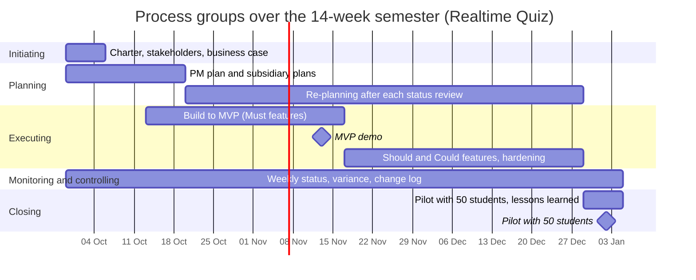

# Process groups mapping: Realtime Quiz platform

This document maps the five project management process groups across the 14-week semester for the Realtime Quiz project, illustrating their overlapping and iterative nature in accordance with the *Process Groups Practice Guide (2022)* and *PMBOK Guide*.

## 1. Process groups across the 14-week semester

| Process group | Weeks active | Main activities | Outputs | Lab that produces them |
|---|:---:|---|---|---|
| **Initiating** | 1 | Develop project charter, identify initial stakeholders, analyze economic viability, secure sponsor authorization | Project charter, stakeholder register (CSV and MD), business case (CSV and MD) | Lab-01 |
| **Planning** | 1–3 (initial burst); 4–14 (continuing re-planning) | Initial burst: scope decomposition, WBS, schedule network, cost budgeting, quality, staffing, risk, and communications. Continuing: re-planning on variance, schedule compression, re-baselining upon approved change requests | Scope statement, WBS & dictionary, schedule baseline (Gantt), cost baseline, RACI matrix, risk register, updated baselines, corrective actions | Labs 02 to 12 (initial baseline), every lab (practice) |
| **Executing** | 3–13 | Build software increments (backend JPA, real-time WebSocket/STOMP, frontend UI), unit & integration tests, weekly software demos, load testing | Working software increments, MVP release (week 7), load test reports (week 12), deployment scripts | Monitored in Labs 07, 08 (built in capstone) |
| **Monitoring and controlling** | 1–14 | Conduct weekly status meetings, track schedule and cost variance (EV, PV, AC, SV, CV, SPI, CPI), review risk register, manage change requests, audit quality | Weekly status reports, change log, updated baselines, risk review minutes, quality checklists | Labs 05, 06, 09 (tools), every lab (practice) |
| **Closing** | 14 | Conduct live classroom pilot with 50 students, administer user feedback survey, obtain formal sponsor acceptance, capture lessons learned, hand over to IT operations | Pilot evaluation report, signed acceptance certificate, lessons-learned post-mortem, production operational runbook | Lab-01 (post-mortem), Lab-12 (hand-over) |

## 2. Mermaid Gantt chart

## 3. Phase gates

In alignment with PRINCE2 principles of continued business justification and stage-gate governance, the project features three decision gates where the sponsor evaluates verifiable evidence to decide whether to continue, change, or terminate the project:

1. **Gate 1: Charter Approval & Initiation Gate (Week 1)**
   - **Decision:** Authorize project launch, release the 200 USD cash budget, and assign team resources (4 students at 8 h/week and PM at 3 h/week).
   - **Required evidence:** Signed [project charter](project-charter.md), populated [stakeholder register](stakeholders.md), and validated [business case](business-case.md) confirming positive net benefits (4,500 USD/year) and a 1.1-year payback period.
2. **Gate 2: MVP Viability Checkpoint (Week 7)**
   - **Decision:** Authorize progression to secondary features (Should/Could scope) and pilot preparations, or enact contingency off-ramp.
   - **Required evidence:** Live, working demonstration of 100% of core Must features (quiz authoring, synchronized session runner, timer, automatic scoring, and live leaderboard) functioning with 0 critical defects. If the demonstration fails and recovery within the 25 USD reserve is impossible, the sponsor terminates internal development and triggers Option B (procuring commercial SaaS for next semester).
3. **Gate 3: Pilot Readiness & Hand-Over Gate (Week 13)**
   - **Decision:** Authorize the week 14 live classroom deployment with 50 enrolled students and initiate operational transition to departmental support staff.
   - **Required evidence:** Verified green test report from the 100-student concurrency load test (latency $\le 500\text{ ms}$ at 95th percentile), formal written data protection approval from the Data Protection Officer (S09), and completed operational runbook and Docker Compose production deployment files delivered to IT operations (S06).
