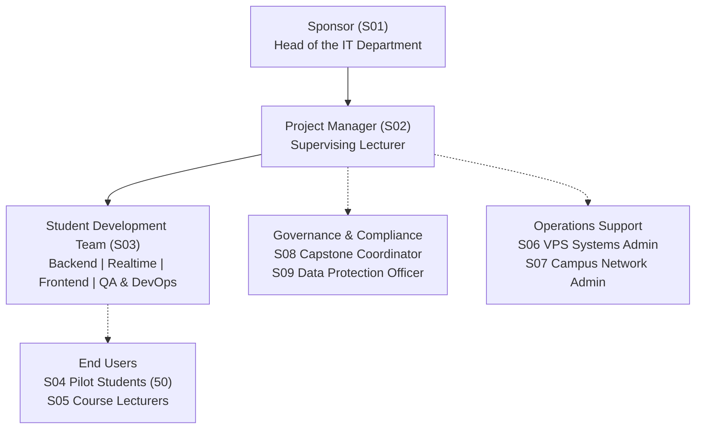

# Stakeholder register: Realtime Quiz platform

This document complements [`stakeholders.csv`](file:///c:/Users/M/OneDrive/Documents/ITC/Year3_sem1/IT%20Project%20Management/Lab/pm-plan-ChhengKimter/lab01/stakeholders.csv) by providing an analysis of stakeholder priorities, governance relationships, and project organizational structure.

## 1. Stakeholder register

| ID | Name / Group | Role | Category | Influence | Interest Level | Main Interest | Key Expectation |
|---|---|---|---|:---:|:---:|---|---|
| S01 | Head of the IT department | Sponsor | sponsor | H | H | A reusable quiz tool that saves marking time and demonstrates departmental innovation | MVP demo in week 7 and a pilot with 50 students in week 14 delivered within the 200 USD cash budget. |
| S02 | Supervising lecturer | Project manager | pm | H | H | Successful project delivery meeting academic standards without schedule or cost overruns | Expects timely decision sign-offs from the sponsor within 5 working days and dedicated 8 hours weekly from each student. |
| S03 | Student team (4) | Developers and testers | team | M | H | Hands-on engineering experience, clear technical guidance, and fair evaluation | Expects stabilized MVP requirements by week 4, clear task assignments, and weekly progress reviews. |
| S04 | Pilot students (50) | End users (students) | user | L | M | A responsive and engaging in-class quiz experience without timer or connection glitches | Expects easy session join with a numerical code and real-time score display without connection drops in week 14. |
| S05 | Course lecturers | End users (instructors) | user | M | H | Reduced grading workload and real-time insight into student lecture comprehension | Expects an intuitive quiz authoring dashboard and automated grade export in CSV format ready for week 14 pilot testing. |
| S06 | IT operations (VPS admin) | Systems administrator | operations | M | M | Stable deployment, low maintenance overhead, and predictable resource utilization | Expects a deployment checklist and production docker-compose configuration two weeks before the pilot. |
| S07 | Campus network administrator | Network infrastructure admin | operations | M | L | Compliance with campus network security and seamless WebSocket proxy traffic | Expects WebSocket port specifications and traffic load estimates submitted by week 3 to verify proxy configurations. |
| S08 | Software Engineering capstone coordinator | Academic evaluator | governance | H | M | High engineering quality, complete lifecycle documentation, and rigorous testing | Expects traceable git commits, automated test coverage exceeding 80%, and an MVP demonstration in week 7. |
| S09 | Data protection officer | Approves storage of student data | governance | H | L | Student data privacy compliance and local hosting with clear retention rules | Expects a one-page data description before the pilot with authority to veto live deployment if privacy rules are breached. |
| S10 | Commercial quiz SaaS vendor | Alternative solution provider | external | L | L | Selling proprietary quiz platform licenses to the department if custom build falls short | Expects benchmark quote requests and evaluation against commercial terms during the business case review at week 7. |

## 2. Priority stakeholders (High Influence, High Interest)

The two stakeholders with high influence and high interest are the **Head of the IT department (S01, Sponsor)** and the **Supervising Lecturer (S02, Project Manager)**, and they demand the project manager's closest ongoing attention because they define project success and hold executive authority. The Sponsor provides the funding, controls departmental resources, and possesses sole approval power over major scope variations and milestone acceptance, meaning any loss of alignment risks project cancellation. Meanwhile, the Project Manager coordinates the student developers, manages day-to-day variances, and ensures that engineering standards and semester milestones are strictly met. Maintaining continuous transparency and weekly status alignment between S01 and S02 ensures rapid issue resolution, prevents scope drift, and protects the project baseline.

## 3. Veto stakeholder

The **Data Protection Officer (S09)** is the decisive veto stakeholder because the live classroom pilot cannot legally or procedurally proceed without formal approval of the student data storage architecture and privacy retention policy.

## 4. Power / Interest grid

```
High Influence (H)
  ▲
  │   [Keep Satisfied]                 [Manage Closely]
  │   S08 Capstone Coordinator         S01 Sponsor (Head of IT)
  │   S09 Data Protection Officer      S02 Project Manager
  │
  │   [Monitor (Minimum Effort)]       [Keep Informed]
  │   S07 Campus Network Admin         S03 Student Team (4)
  │   S10 Quiz SaaS Vendor             S05 Course Lecturers
  │                                    S04 Pilot Students (50)
  └─────────────────────────────────────────────────────────────► High Interest (H)
```

## 5. Project organization structure


